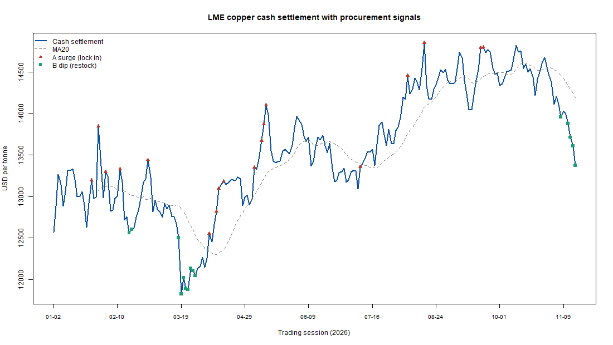

# Copper procurement signal

A small, reproducible pipeline that watches **published LME copper prices** and
flags two different moments for a manufacturer buying copper: when prices are
rising fast (consider locking in early) and when prices fall back near recent
lows (consider restocking). A scheduled job refreshes the data, writes a daily
Markdown report and emails only when a signal fires.

Built as a portfolio project: real market data, explicit units and as-of dates,
configurable rules, a cooldown to suppress duplicate alerts, and an honest
backtest that says what it can and cannot prove.

---

## Problem

A workshop that uses copper (phosphor-bronze washers, terminals, brush holders)
buys raw material at whatever the market price is on the day. Watching one price
is easy; turning that price into a consistent, documented decision is not. A
single "price went up 3%" alert is both noisy and logically backwards — buying
because something got more expensive is a risk action, not a bargain.

So the rule set is split into two independent signals with different meanings,
and no claim is made that either one saves money.

## Data

| Item | Detail |
| --- | --- |
| Series | LME copper **cash settlement**, 3-month price, LME stock |
| Source | [Westmetall market data](https://www.westmetall.com/en/markdaten.php?action=table&field=LME_Cu_cash), publishing LME official settlement data |
| Frequency | End-of-day, trading days only (not real-time) |
| Units | USD per tonne (prices), tonnes (stock) |
| Price history used here | 222 sessions, 2026-01-02 → 2026-11-16, retrieved 2026-11-17; regenerated locally, **not committed** |

The price data is **real and public**. Everything about the business itself —
order size, monthly usage, supplier quotes, inventory levels, thresholds — is
**synthetic or an example value** and is labelled as such in `config.json`.
No company legal name, customer part number, private email address or real
purchase record appears anywhere in this repository.

Two data conventions that matter:

- LME cash (USD/t, international benchmark) is **not** domestic 1# electrolytic
  copper spot (CNY/t). Do not set real purchase thresholds by mixing them.
- The source publishes end-of-day settlement prices. This repo is a research
  demo, not a live market-data service; do not repackage the series as real-time
  quotes. Redistribution rights for exchange data belong to the exchange, so the
  raw daily table **and any row-level derived series are git-ignored and
  regenerated on every run** — only the fetcher, aggregate reports and the
  signal chart are committed.

The fetcher also refuses to treat a stale page as current: it parses the latest
date and warns/fails if the data is older than `max_staleness_days`. This is not
theoretical — a Sina real-time endpoint tested during development returned a
price stamped **2024-07-17**, two years out of date.

## Method

**A · Surge → consider locking in.** Triggers when the 1-session move is at least
`surge_1d_pct` with a non-negative 5-session confirmation, or when the 5-session
move reaches `surge_5d_pct`. The confirmation is there to avoid reacting to a
one-day spike. This is a *risk warning* ("waiting may get more expensive"), not
a cheap-price signal.

**B · Dip → consider restocking.** Triggers when price is at most
`dip_vs_ma20_pct` below its MA20 **and** ranks in the bottom
`percentile_60d_max` of the last 60 sessions. Requiring both conditions avoids
firing during a slow, broad downtrend where "cheap" keeps getting cheaper.

Both use a `cooldown_days` window, recorded in `data/alert_state.json`, so one
price wave produces one alert instead of five near-identical ones. The backtest
section counts **raw** signals without cooldown; the live status table applies it.

Indicators: 1- and 5-session returns, MA20 deviation, 60-session price rank,
cash-vs-3-month basis (contango / backwardation), and 5-session LME stock change.
Basis and stock are available as context only — they do not currently change the
trigger, which keeps the rules auditable.

## Results

Snapshot generated **2026-11-17** from the 2026-11-16 close (see
[`reports/LATEST.md`](reports/LATEST.md)):

| Metric | Value |
| --- | --- |
| Cash settlement | 13,375.00 USD/t |
| 3-month | 13,305.00 USD/t (basis +0.53%, backwardation) |
| 1-session / 5-session change | −1.73% / −4.67% |
| Deviation from MA20 | −5.73% |
| Price rank, last 60 sessions | 2% |
| Signal A / B | WATCH / **TRIGGER** |

Backtest over the 222-session sample: 18 raw A triggers, 15 raw B triggers.
Buying the same total tonnage split evenly across B-trigger days averaged
12,673.37 USD/t versus 13,454.32 USD/t on the first session of each month,
a −5.80% difference **in this sample**.

That number is a price-timing simulation with synthetic volumes. It ignores
premiums, freight, FX, tax, minimum order quantities, supplier terms, carrying
cost and credit lines. It is not realised savings and does not predict prices.
Re-running on a later date will change every figure above.



*Generated by `R/analysis.R` (base R, no packages). Triangles mark A surge
signals, squares mark B dip signals. The chart is a committed snapshot; the
underlying row-level data is regenerated locally.*

## What worked / what didn't

- **Worked:** one free, stable, daily, parseable source with a long enough
  history for a meaningful backtest; a stale-data check; zero third-party
  dependencies in the Python path, so the scheduled job has nothing to break.
- **Didn't:** Yahoo Finance `HG=F` (403), Stooq (JS challenge), FRED CSV
  (timeout), SHFE `kx*.dat` (404), Sina daily-kline for `CU0` (null), and
  Eastmoney `secid=113.cu0` (null) all failed during source evaluation. Domestic
  spot pages (Changjiang / SMM) load but expose prices behind subpages or JS,
  and commercial terms would need checking before automated use.
- **Deliberately not built:** live/intraday polling, a trading or purchasing
  execution path, a price forecast, and any claim of cost savings.

## Reproduce

Requires Python 3.10+ (standard library only) and, for the R path, base R.

```bash
python scripts/fetch_prices.py          # download the price CSV (git-ignored), verify as-of date
python scripts/daily_report.py          # write reports/YYYY-MM-DD.md + LATEST.md
Rscript R/analysis.R                   # optional: R indicators, CSV and PNG chart
```

`daily_report.py --no-state` ignores cooldown (useful for re-running the demo),
and `--send-email` attempts an SMTP delivery when a signal triggers.

Both Python scripts and `R/analysis.R` were executed and verified on the
authoring machine (R 4.6.2). The R path reproduces the same 222 sessions,
18 raw A / 15 raw B triggers, 13,454.32 USD/t baseline, 12,673.37 USD/t dip
average and −5.80% delta, so the two implementations agree. The chart is
committed as `reports/r_signals.png`; the row-level indicator table written by
R is git-ignored, like the raw price CSV, and is regenerated by the command
above.

## Repository layout

```
config.json                     all thresholds, clearly marked as example values
scripts/fetch_prices.py         source -> normalised CSV, with staleness guard
scripts/daily_report.py         indicators, signals, cooldown, backtest, report, email
R/analysis.R                    base-R implementation + chart (run locally)
data/prices_lme_cash.csv        generated locally by the fetcher, git-ignored
data/alert_state.json           last trigger dates for cooldown
reports/LATEST.md               most recent generated report
reports/YYYY-MM-DD.md           dated report history
reports/r_signals.png           R chart: price, MA20 and both trigger families
.github/workflows/daily.yml     scheduled job
```

## Automation

`daily.yml` runs at 22:00 UTC on weekdays (06:00 Beijing the next morning):
it downloads the prices into a git-ignored CSV, rebuilds the report, and commits
only the report and the cooldown state. Email is sent only when a signal
triggers. Configure five repository secrets:

`SMTP_HOST`, `SMTP_PORT` (default 465), `SMTP_USER`, `SMTP_PASS` and `ALERT_TO`.
Without them the job still produces the report and prints `email: skipped`.
Credentials are never stored in the repository.

The cooldown state is committed with the report, so it survives between
scheduled runs. A fresh clone (or `--no-state`) starts with no cooldown.

## Limitations

Short history (about one year), one international benchmark, end-of-day only,
example thresholds, and a price-only comparison. Before any operational use the
thresholds must be confirmed with the business, a domestic CNY/t spot series
should be added as a second source, and the rules should be validated against
actual purchase records. Research and portfolio demonstration only — not
purchasing, trading or investment advice.

## License

MIT. See [LICENSE](LICENSE).
